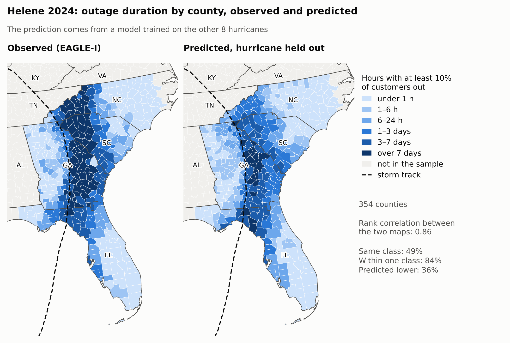
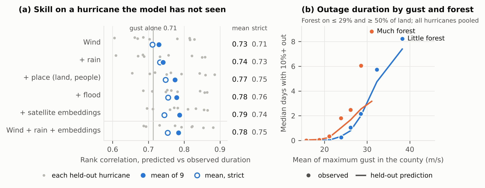
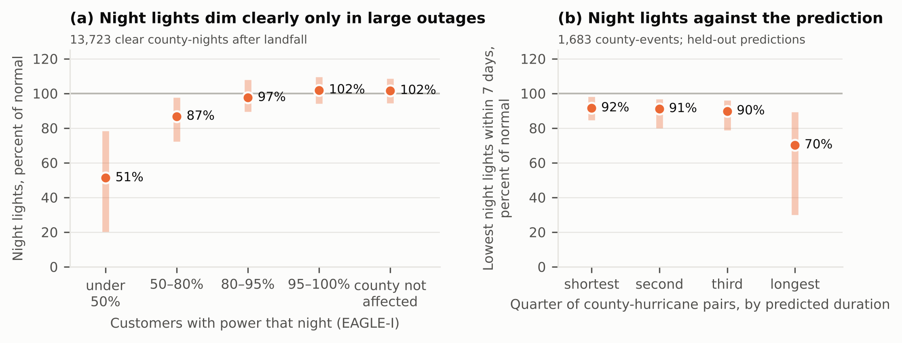

# What explains how long the power stays out?

**County power-outage duration across nine U.S. hurricanes, 2017–2024**

Wind explains most of which counties stay without power longest in a hurricane. A model that has never seen a storm ranks its counties by outage duration with a rank correlation of 0.77; ranking them by gust alone already gives 0.71. With boosted trees, local characteristics add 0.03 and rain 0.01; only the first clears my threshold, and neither does with a linear model. My radar flood measure adds nothing, and satellite foundation-model embeddings can stand in for hand-built local variables but do not add to them.

The two-page summary is in [`brief.pdf`](brief.pdf).



*Helene 2024, predicted by a model trained on the other eight hurricanes. It finds the corridor east of the track but underestimates the longest outages: 68 counties were out for more than 7 days, and it predicted 21.*

## Question

Which public data explain how long a county stays without power after a hurricane, when the model is tested on a hurricane it has not seen?

- **Outcome**: hours with at least 10% of a county's customers out, from [EAGLE-I](https://doi.org/10.1038/s41597-024-03095-5), the 15-minute county outage record of Oak Ridge National Laboratory.
- **Sample**: 1,767 county-hurricane pairs in 617 counties and 8 states. Hurricanes: Irma 2017, Florence 2018, Michael 2018, Laura 2020, Zeta 2020, Ida 2021, Ian 2022, Beryl 2024, Helene 2024. Eleven were screened; Harvey and Sally had too few long outages on record. The states studied for each hurricane were chosen by hand. Within them, a county enters when it has EAGLE-I records and lies inside the 34-knot wind radius or receives 100 mm of rain in 3 days. In 620 pairs the outage reached 24 hours, and in 756 it never reached 10%.
- **Standard test**: leave one hurricane out. Train on eight, predict the ninth, repeat nine times. The score is the Spearman rank correlation between predicted and observed duration inside the held-out hurricane, averaged over the nine.
- **Rule fixed in advance**: a group of variables helps if the mean score on the standard test rises by 0.02 and at least 6 of 9 hurricanes improve. Embeddings "can replace" place variables if they score no more than 0.02 lower.
- **Strict test, added after the main results were known**: the held-out hurricane's counties are also removed from training. This test trains on less data too (a median of 1,164 pairs instead of 1,638), so a lower score has two possible causes.

The model is explanatory, not a forecast: it uses observed wind and rain.

## Results

Mean score over the nine held-out hurricanes:

| Variables | Standard test, boosted trees | Strict test, boosted trees | Standard test, ridge regression |
| --- | --- | --- | --- |
| Gust alone, no model | 0.71 | | |
| Wind (8 variables) | 0.73 | 0.71 | 0.76 |
| + rain (3) | 0.74 | 0.73 | 0.77 |
| + place: land cover, terrain, population, housing (20) | 0.77 | 0.75 | 0.77 |
| + flood: Sentinel-1 extent, land close to stream level (10) | 0.78 | 0.76 | 0.77 |
| + AlphaEarth satellite embeddings (64 dimensions, reduced to 16) | 0.79 | 0.74 | 0.76 |
| Wind + rain + embeddings, no place variables | 0.78 | 0.75 | 0.77 |

Change in the mean score when a group is added, with the number of hurricanes that improve:

| Added | Standard test, boosted trees | Strict test, boosted trees | Standard test, ridge regression |
| --- | --- | --- | --- |
| Rain, to wind | +0.012 (7 of 9) | +0.021 (8 of 9) | +0.009 (6 of 9) |
| Place, to wind and rain | +0.033 (9 of 9) | +0.016 (7 of 9) | +0.004 (5 of 9) |
| Flood, to all of the above | +0.004 (5 of 9) | +0.007 (6 of 9) | +0.003 (5 of 9) |
| Embeddings, to all of the above | +0.009 (7 of 9) | −0.011 (3 of 9) | −0.008 (1 of 9) |



1. **Wind dominates the ranking.** Shuffling the wind variables in the full model costs 0.66 of the score. Shuffling any other group costs at most 0.03. The score of the wind, rain and place model runs from 0.65 (Michael) to 0.89 (Beryl).
2. **Only place passes the rule, and not robustly.** Place clears the bar on the standard test (+0.033, all nine hurricanes) and falls below it on the strict test (+0.016). Rain does the reverse, by a margin that disappears with another library version (+0.021 with scikit-learn 1.6.1, +0.016 with 1.9.1). With a ridge regression no group beyond wind passes. One pattern behind place: at gusts of 27.5 to 30 m/s, the most forested third of pairs was out for a median of 145 hours, against 52 for the least forested third. Half of those forested pairs come from Helene, so forest and storm are hard to separate.
3. **The radar flood measure adds no skill.** It also failed its own check: flooded share and 3-day rain correlate at only 0.01, or 0.07 with cropland excluded. Only 61% of pairs had a Sentinel-1 image of most of the county within 6 days of landfall, and cropland made up 39% to 72% of the flagged area in a typical county, depending on the storm. This says little about flooding itself.
4. **Embeddings can stand in for hand-built place variables but do not add to them.** Wind, rain and embeddings score 0.78, against 0.77 with the 20 place variables (0.75 for both on the strict test). Added on top, embeddings give +0.009, and −0.011 on the strict test. That fits some memorizing of places, though the strict test also trains on less data.
5. **Night lights agree with the predictions where they respond at all.** They were kept out of the model. NASA Black Marble brightness fell to a median of 51% of normal on nights when under half of a county's customers had power, to 87% when 50% to 80% had power, and stayed at 97% when 80% to 95% had power. In the quarter of pairs with the longest predicted outages, the darkest clear night within 7 days had a median of 70% of normal, against 90% to 92% in the other quarters. The rank correlation between prediction and dimming is 0.35 overall (0.37 for the observed duration) and runs from −0.03 (Zeta) to 0.64 (Laura) by hurricane.



### Limits

- **Severity of a new storm.** The model ranks counties well but misjudges the overall level. In the worst case, Irma, it predicted 13% of counties over 24 hours and 52% were. Pooled over all hurricanes, R² on log hours is 0.49 with wind alone and 0.61 with all variables.
- **Small gains are fragile.** Between scikit-learn 1.6.1 and 1.9.1 the tree-model gains in the table moved by up to 0.006, and the counts of hurricanes that improve moved by one or two. The 1.9.1 tables are in `us_flood_outage/check_scikit-learn_1.9.1/`, and `step5_version_check.csv` sets the two versions side by side.
- **A linear model ranks about as well.** A ridge regression on wind alone scores 0.76, and with it no added group passes the rule. With all variables the trees are ahead (0.79 against 0.76).
- **Zeros.** In 43% of pairs the outage never reached 10%. A model trained and tested only on the pairs that did reach it scores 0.74.
- **Embeddings.** With the raw 64 dimensions instead of 16 principal components, both embedding models score 0.77. Irma (September 2017) uses the 2017 embedding, which includes the months after the storm, because no earlier year exists.
- **Nine storms, county scale.** EAGLE-I covers only utilities that publish outage maps, and customer totals per county are estimated. A second set of customer totals leaves the score unchanged (0.775 against 0.774).
- **Checks that failed.** Two of the checks set before Step 3b failed and are reported as failed: the nightly correlation between night lights and the share of customers with power (0.30, target 0.40) and the correlation between flooded share and rain (0.01, target 0.20).

## Repository

```
brief.pdf                 two-page summary
notebooks/                seven notebooks, in the order they run
us_flood_outage/          the working folder the notebooks read and write
figures/                  the figures shown on this page
DATA_SOURCES.md           every input, with its terms and citation
requirements.txt
```

| Notebook | What it does | Needs Earth Engine |
| --- | --- | --- |
| `step1b_florence_feasibility` | Tests the three data sources on one hurricane | Yes |
| `step2c_event_library_labels` | Outage labels for every county and hurricane, from EAGLE-I | For a small part |
| `step2d_customer_totals` | Checks the customer totals used as the denominator | No |
| `step3a_hazard_and_static_features` | Wind, rain, land, population, satellite embeddings | Yes |
| `step3b_flood_and_night_lights` | Sentinel-1 flood extent and Black Marble night lights | Yes |
| `step4_modeling` | Leave-one-hurricane-out models, comparisons, robustness checks | No |
| `step5_figures` | Final figures, the comparisons under the strict test and with ridge, and the table of numbers quoted here | No |

Steps 1b, 2c and 2d carry the letter of their final revision; 3a and 3b are the two halves of Step 3. Only the final version of each notebook is here.

`us_flood_outage/` holds the county-level tables each step produced, so the modeling can be rerun without Earth Engine. Raw downloads, caches and a few intermediate files are left out. `step5_key_numbers.csv` lists the numbers quoted in the brief and on this page, with the file each comes from.

## Reproduce

**Modeling and figures only (no Earth Engine, about 5 minutes).**

In Google Colab:

1. Copy the folder `us_flood_outage/` to the top level of your Google Drive.
2. Open `notebooks/step4_modeling.ipynb` in Colab and run all cells (3 to 5 minutes).
3. Open `notebooks/step5_figures.ipynb` and run all cells (under a minute). It downloads county outlines from GitHub once.

On your own machine:

```
pip install -r requirements.txt
jupyter lab
```

Then run the same two notebooks. They find `us_flood_outage/` one level above `notebooks/`.

**Full pipeline.** Steps 1b to 3b rebuild the tables from the original sources. Steps 1b, 2c, 3a and 3b need a Google Earth Engine Cloud project (set `PROJECT_ID` in cell 2). Step 3a also needs a free Census API key, stored as a Colab secret named `CENSUS_KEY`. Steps 2c and 2d download several gigabytes of EAGLE-I files. Steps 1b and 3b write their Sentinel-1 statistics through Earth Engine export tasks to a Google Drive folder named `us_flood_outage`, so they are meant to run in Colab with Drive mounted; on a local machine the exported files have to be copied into `us_flood_outage/`.

**Versions.** The reported numbers were reproduced exactly with Python 3.12, numpy 2.0.2, pandas 2.2.2, scipy 1.15.3 and scikit-learn 1.6.1. With another scikit-learn version the tree-model numbers change in the second or third decimal; the ridge numbers do not.

## Data sources

All inputs are public. [`DATA_SOURCES.md`](DATA_SOURCES.md) lists each one with its terms and citation. The AlphaEarth Foundations Satellite Embedding dataset is produced by Google and Google DeepMind.

## Related project

An earlier project, `ph-typhoon-outage-transfer`, studies power recovery after Philippine typhoons, where night lights are the only observation of outages. This project tests that measurement against recorded outages.

## License

Code: MIT, see [`LICENSE`](LICENSE). The tables in `us_flood_outage/` are derived from the sources in `DATA_SOURCES.md` and remain subject to their terms.
